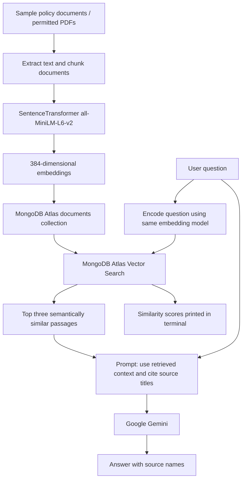

# RAG Workflow

## Ingestion

- `python app.py --seed` embeds and stores four synthetic policy records. **It deletes all existing records in the configured collection**, so only run it when resetting a demo dataset is safe.
- `python ingest_pdf.py` scans local PDFs, extracts text per page, splits it into character chunks, computes embeddings, and replaces prior chunks from the same filename. This preserves other documents.

## Retrieval and generation

1. Encode the question using the same embedding model used for ingestion.
2. Query MongoDB's `$vectorSearch` index on the `embedding` field with 100 candidates and three results.
3. Assemble returned text and source titles into the context.
4. Request a context-grounded answer from Gemini and instruct the model to indicate when evidence is missing.
5. Print the answer and the scores for retrieved passages.

**Note:** Vector similarity is a retrieval measure, not a measure of answer correctness.